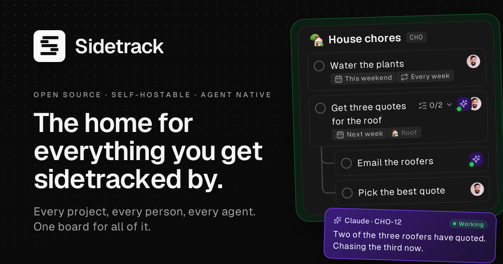

# Sidetrack

There's always something to do, and too much to keep track of. Some of it
solo, some shared, some you're hacking on with an agent.

Sidetrack gives each one a simple list, side by side, so you can see it all at
a glance.

Assign tasks to people, or agents, who automatically pick up the work and
report back as they go.

- 🤖 **Agent first.** Agents read and update your lists over
  [MCP](https://modelcontextprotocol.io), mark what they're working on, and
  link their pull requests
- 📁 **Lists, items and sub-items**, with emoji labels, due dates, repeats and
  drag to reorder
- 🗓️ **Brief, Board and Done** views that update live
- 👥 **Sharing.** Share a list with someone, or keep lists in a Space for a
  household or small team
- 🔀 **GitHub.** Pull requests that name an item link to it, and complete it
  when they merge ([setup](docs/github.md))
- 📜 **Audit log.** Every change is recorded with who made it: you, a
  collaborator, an agent or GitHub
- 📱 **Installable** as an app (PWA) on iPhone, iPad and Mac. On a Mac, open
  it in Safari and choose File → Add to Dock, or install it from Chrome or Edge

## Get started

- **Hosted:** sign up at [sidetrack.it](https://sidetrack.it).
- **Self-hosted:** run one Docker container on your own server. See the
  [self-hosting guide](docs/self-hosting.md).

## Connect an agent

Agents connect to the MCP server at `/mcp` with a personal API key.

1. **Create a key** from **API keys** in the menu under your avatar. Copy it
   straight away: it's only shown once.
2. **Add Sidetrack to your agent.** Replace `your-host` with your instance's
   address, such as `sidetrack.it`.

**Claude Code:**

```bash
claude mcp add --transport http sidetrack https://your-host/mcp \
  --header "Authorization: Bearer sk_…"
```

**claude.ai:** Settings → Connectors → add a custom connector with the URL
`https://your-host/mcp?key=sk_…`.

**Other clients:** `https://your-host/mcp`, with the header
`Authorization: Bearer sk_…`, or the `?key=` URL if they can't set headers.

- **claude.ai can't send headers**, so its key goes in the URL. Treat that URL
  as a secret.
- **Hosted clients such as claude.ai need a public HTTPS address** for a
  self-hosted instance (see
  [HTTPS and a domain](docs/self-hosting.md#https-and-a-domain)). A client on
  the same machine can use `http://localhost:3000/mcp`.

Agents can read and search your lists, add, edit, complete and move items,
mark the item they're working on and report progress, link pull requests, and
manage sharing. A key acts as the person who created it. Its changes show in
the audit log under the key's name, and you revoke it from the same page.

## Contributing

Sidetrack is built with [Next.js](https://nextjs.org),
[React](https://react.dev), [SQLite](https://www.sqlite.org) via
[Drizzle ORM](https://orm.drizzle.team), and
[Tailwind CSS](https://tailwindcss.com) with [shadcn/ui](https://ui.shadcn.com).
See [`CONTRIBUTING.md`](./CONTRIBUTING.md) to run it locally and make changes.

## License

Sidetrack is licensed under the
[GNU Affero General Public License, version 3 (AGPL-3.0-only)](./LICENSE).
Copyright © 2026 Jotmake Limited. In short:

- You may use, copy, modify, self-host and redistribute Sidetrack for any
  purpose, including commercially.
- If you modify it and let other people use it over a network, such as by
  hosting it for them, you must offer them your modified source code under
  the same license.

See [`LICENSE`](./LICENSE) for the full terms. Versions released before the
switch to the AGPL remain under the
[FSL-1.1-ALv2](https://github.com/fredrivett/sidetrack/blob/d5d4a56c6285cd916b8a54692aa6d52c8ebd5efb/LICENSE.md)
they shipped with, and each converts to the
[Apache License, Version 2.0](https://www.apache.org/licenses/LICENSE-2.0) two
years after its release.
